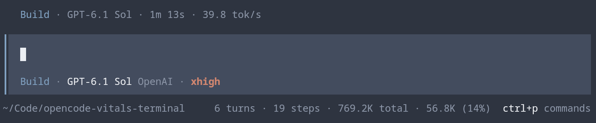
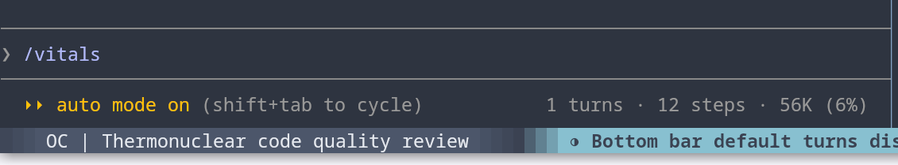

# Session Vitals

Session usage where you already look: in the prompt footer and sidebar of your terminal coding agent.

Both plugins show the same things — turns, model steps, context usage, cumulative tokens, cost, and tool-call statistics — rendered natively by the host rather than in a separate dashboard. Neither makes extra model requests, and neither sends telemetry.

| Plugin | Host | Docs |
| --- | --- | --- |
| [`opencode/`](opencode) | OpenCode V2 (full-screen terminal client) | [README](opencode/README.md) |
| [`claude-code/`](claude-code) | Claude Code | [README](claude-code/README.md) |

## Screenshots

**OpenCode** — footer line, plus a Vitals section in the sidebar:



**Claude Code** — footer line on the mode lane, plus a Vitals pane:



## Install

**OpenCode** — add the npm package to `plugins` in `~/.config/opencode/cli.json`, keeping your existing entries:

```json
{
  "$schema": "https://opencode.ai/v2/cli.json",
  "plugins": [
    "-opencode.prompt.footer",
    "-opencode.sidebar.context",
    "opencode-session-vitals"
  ]
}
```

The two `-` entries turn off the built-in footer token line and Context section that Vitals replaces. Requires OpenCode V2 2.0.26 or later. See [opencode/README.md](opencode/README.md#install) for what each entry does and how to install from source.

**Claude Code** — at the prompt:

```text
/plugin install session-vitals --marketplace skatkov/session-vitals-plugin
```

## Development

The two plugins are independent: no shared code, no root package. Work in the directory you care about.

**OpenCode** (Node 26.4.0+, or `mise install` for the pinned version):

```sh
cd opencode
npm ci
npm run check          # tsc --noEmit
npm test               # unit tests
npm run test:mutation  # Stryker, 100% threshold
```

**Claude Code** (hot-reloads on save):

```sh
claude --plugin-dir ./claude-code
claude plugin validate ./claude-code
claude plugin test ./claude-code
```

## Contributing

Issues and pull requests are welcome.

- Branch off `main` and keep each pull request to one change.
- Touch one plugin per pull request where you can.
- For OpenCode changes, `npm run check` and `npm test` must pass. New logic in `opencode/src/` needs tests: mutation testing runs at a 100% threshold, so an uncovered branch fails the build.
- Note user-visible OpenCode changes under `## [Unreleased]` in [opencode/CHANGELOG.md](opencode/CHANGELOG.md).

Releases are tagged per plugin: `opencode-v0.3.1` publishes the npm package, `claude-code-v0.1.0` marks a Claude Code plugin release.

## License

MIT
