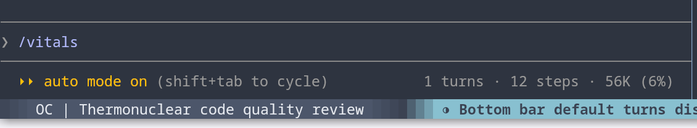

# Claude Code Vitals

**Session usage in Claude Code's prompt footer and a Vitals pane.**

A Claude Code mod (function-hooks plugin) the sibling of [OpenCode Session Vitals](../opencode/README.md) in this repository. It shows turns, model steps and context usage at the right of the prompt footer, on the same lane as the mode labels, plus cumulative tokens, cost and tool-call statistics in a pane beside the chat. It makes no extra model requests and sends no telemetry.

```text
8 turns · 42 steps · 24K (19%)
```



Each figure appears once it has something to say, so the footer stays empty on a fresh session and until the first response reports a context reading.

The **Vitals** pane (docked beside the transcript in fullscreen on wide terminals, or opened with `/vitals`):

```text
Turns: 8
Steps: 42
Total tokens: 320,000
  input: 12,000
  output: 18,000
  cache read: 270,000
  cache write: 20,000
Context: 24,000 (19%) of 200K
Cost: $0.43
Tool calls: 52
  Read: 18
  Grep: 12
  rubydex (subtotal): 10
    get_declaration: 6
    get_descendants: 4
  Bash: 6
```

## What it counts

| Metric | Source |
| --- | --- |
| Turns | Prompts you sent this session |
| Steps | Model requests on the main loop |
| Tokens | Provider-reported usage of every model request, subagents included |
| Context, cost | The same figures as Claude Code's own status line and `/cost` |
| Tool calls | Every tool call, built-in and MCP; MCP tools grouped per server |

On a resumed session the earlier history carries no per-request usage, so steps are counted from the transcript and tokens only from this process on; those figures are marked `~`. `/clear` starts the counts over.

## Commands

- `/vitals`: open the pane and print the full breakdown.
- `/vitals-refresh`: recount turns, steps and tool calls from the transcript.

## Install

```text
/plugin install session-vitals --marketplace skatkov/session-vitals-plugin
```

For development, see the [root README](../README.md#development).

## License

MIT
